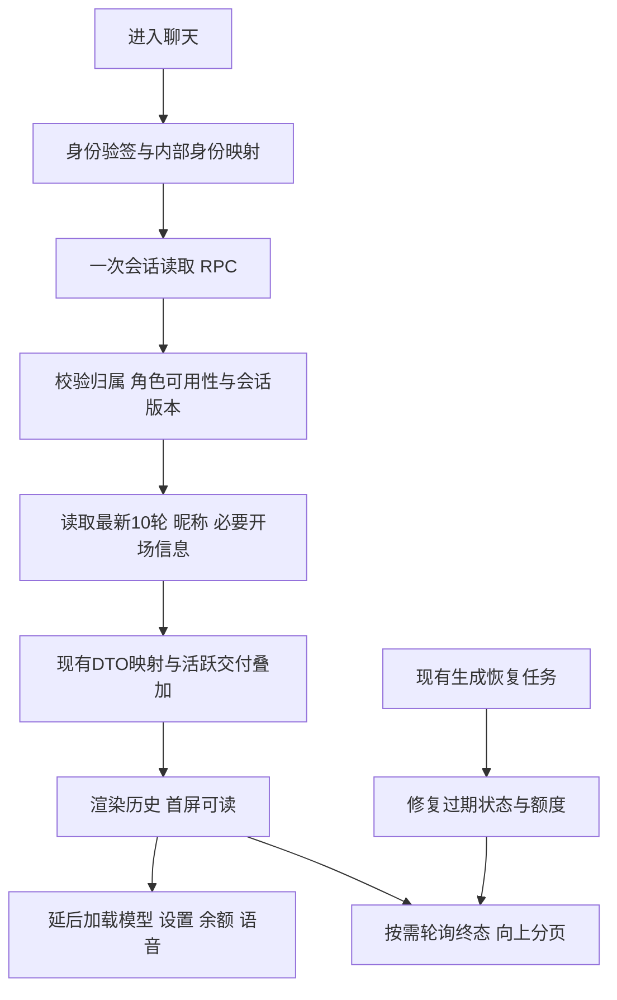

# 聊天历史优先读取与对话错误治理方案

日期：2026-11-23。状态：用户已授权实施并启动任务；最小必要并行、首屏、超时、日志及stale扫描代码已落地，尚未部署。真实TEST、恢复容量和生产P95验收待完成。当前不创建迁移。

本轮补充的硬约束见[功能一致性、日志与聚合边界](./acceptance-and-observability.md)：聚合仅是候选，必须通过功能等价、负载对照和真实stdout验证。与下文简述冲突时，以该补充约束为准。

## 1. 用户体验与目标

进入已有聊天时，先显示最近历史、会话标题和当前消息状态；头像等内容按实际数据逐步补齐。模型目录、偏好面板、余额、语音和教程不阻塞历史显示。必要权限、角色可用性、昵称替换与历史版本保持正确。

建议首屏读取最近 **10 轮，通常约 20 条消息**，而不是目前默认 25 轮、约 50 条。开场白可能另外占一条，删除或未完成轮次可能更少，不以“恰好20条”判断完整性。向上滚动沿用现有分页读取全部历史；不改变发送给模型的上下文轮数、记忆、正文或用户已加载的历史。

这里的“快速显示”指真实历史已经渲染并可阅读，不提前结束计时、不用空列表冒充成功。新会话继续复用创建响应中的消息，不紧接着重复 GET。

## 2. 生产基线与证据边界

观测窗口：北京时间 **2026-11-21 00:00（含）至 11-23 00:00（不含）**，与上轮周末 P95 对比一致；不是截至当前时刻的滚动48小时。页面与接口来自 Grafana，错误来自 Railway production / gallant-insight / stminiapp。

| 指标                                 | Android 基线 / 样本 | iOS 基线 / 样本   | 建议第一轮验收目标                  |
| ------------------------------------ | ------------------- | ----------------- | ----------------------------------- |
| 实际 `/chat/:id` 导航 P95            | 4480.804ms / 741    | 3153.736ms / 138  | Android ≤2500ms，iOS ≤2200ms        |
| 挂载到 ready P95                     | 2153.193ms / 1415   | 1881.416ms / 258  | 两端分别观察，不与导航 P95 相减     |
| GET 会话详情逻辑请求 P95（成功样本） | 2330.692ms / 10681  | 1913.361ms / 1667 | Android ≤1500ms，iOS ≤1300ms        |
| GET 详情 body 阶段 P95               | 1098.168ms          | 815.501ms         | 两端分别争取较同口径基线降低30%以上 |

目标是待生产验证的工程目标，不是已实现效果或时延保证。接口基线含轮询/刷新，尚不能单独代表进入首屏；上线前后保留相同旧口径，另增加首屏/分页/轮询维度。body 含下载、读取、JSON解析及事件循环等待，不等于纯解析CPU时间。不同阶段、平台、页面的 P95 不能相加或相减。

同一请求的 Railway 慢样本已证明：昵称读取出现1270ms，过期 streaming 扫描出现1161ms，历史分页 RPC 出现1972ms。它们是三个不同样本，不拼成一个总耗时。数据库 transport 到响应头的耗时不等于 SQL 执行时间，不能据此直接加索引。

生产后端已核对 cf263edc 版本成功部署，不能把本轮问题归因为周四优化“没有上线”。当前工作区 HEAD 为53eb4977，实施前需重新比较生产与分支，尤其免费额度和结算行为；README 的“本地候选”不是部署证据。

性能证据保留在[上轮任务](../11-23-performance-comparison-nov17-18-vs21-22/verification.md)、[聊天诊断证据](../11-23-performance-comparison-nov17-18-vs21-22/chat-diagnosis-evidence.json)。本轮错误证据见[脱敏 Railway 明细](./railway-error-evidence.json)。

## 3. 当前依赖链与拟改链路

当前服务端不是所有读取完全串行，而是 **三个组串行、每组部分并行**：身份映射 → 会话权限与昵称并行 → stale恢复与角色开场读取并行 → 历史分页 → 映射返回。最慢的组成员会拖住后面的历史读取。Frontend 当前 ready 只依赖会话详情成功，部分次要内容已延后，不能把已有延后加载再当作新增收益。

一次 RPC 指 **Backend 到 Supabase 的一次读取往返**，不是将数据库内部所有查询变成并行，也不承诺整个请求只执行一条 SQL。鉴权和缓存未命中的身份映射仍然必要。

不强制所有读取合成一个RPC：只聚合首屏必需的小范围数据，轮询/分页可以复用更合适的内部执行路径，但保持同一DTO和前端状态源。候选若功能不等价、比原链慢、查询负载恶化或内部成本无法解释，缩小范围或采用最小必要并行读取；不得为了减少RPC数量扩成业务大接口。

### 3.1 T1：聚合会话读取，压缩串行往返（P1）

- 保留 HTTP `GET /api/v1/conversations/:id` 与 `GetConversationData {session,messages,has_more}`，复用现有 `limit`、`before_turn_index`，不新建浏览器入口接口。
- 新增一个有业务职责的内部读 RPC，建议名 `experience.read_chat_entry`；将会话归属/未删除检查、会话行、必要名字字段、角色权限/会话版本及历史页在同一读取快照中组织返回。它不是重命名旧函数或层层套 `*_before_*` 包装。
- 历史选轮继续复用 `list_chat_message_page` 的版本、分支、编辑/删除覆盖、点赞及开场投影规则，避免复制另一套历史 SQL。先按索引选有限轮次，再读展示投影；不从 ops 或统计视图读取产品数据。
- 角色可用性沿用 `read_session_character_runtime` / `read_session_character_version` / `can_use_character` 的现有语义。不能因为这一页暂不显示开场白就跳过角色访问校验。已有会话固定版本、空会话开场更新、官方角色行为均按现有测试保持。
- 昵称从 `app_core.users` 一并返回仅供 Backend 使用的名字字段，复用 `resolveEffectiveDisplayName` 和 `applyUserPlaceholder*`；不缓存可变昵称，不向浏览器泄漏原始用户行。带 postprocess_version 的 assistant 原文仍由原 renderer 处理，不提前替换破坏规则。
- 内部 RPC 返回形状在 repository 内校验会话身份、数组上限、唯一 turn_index、排序与必要字段，沿用映射后才返回 shared DTO。
- 顶部先用已授权会话标题；完整角色详情继续使用已有 viewer/session 隔离 query 补齐，不用大厅当前公开卡覆盖固定会话版本，也不等待头像下载才显示历史。
- 新RPC禁止生成/计费/恢复写入、模型/钱包/全量设置、完整角色runtime及全历史统计；历史先选有限轮次再关联，不做N+1。开场内容仅在该页需要时读取，权限/版本检查始终保留。实际是否保留聚合由同条件的功能与性能/负载对照决定。

### 3.2 T2：首屏减量、保留缓存与稳定分页（P1）

- Frontend 在原详情请求显式带 `limit=20`；旧客户端未传参数仍保留默认50的约定。更早历史保持原分页大小与游标规则，不后台一次补齐全部历史。
- 详情/发送后刷新/streaming轮询对同一缓存采用一致的首屏大小；用途只影响调度和遥测，不能因 entry/polling 创建两份状态源。`fetchConversationDetail` 同时用于取消定位等路径，逐个核对调用者，不能只改单个页面。
- 更早历史仍由当前分页状态保存。首屏刷新不得清空已加载页；以会话、turn_index、revision、message id合并，保留编辑版本/删除/点赞，防止迟到旧页覆盖新回复。切会话、分支和离页请求保持身份校验及滚动锚点。
- 复用 React Query 的已有内存数据和创建结果免重复GET逻辑，不新增 localStorage/IndexedDB 聊天缓存。现有详情 key 只有 sessionId，尚未发现统一换号清理；本轮不扩大其生存期、不新增预取。若实施需要延长或跨账号复用，必须先补可信 viewer 隔离/切换清理并回归全部 mutation。
- 模型、钱包、语音等沿用 entry enrich/background，只在历史提交后启动；界面有相应局部加载/失败状态。发送前仍由服务端做真实模型、权限、报价和额度校验，不能用未加载默认值覆盖用户偏好。
- 暂不引入虚拟列表库、全量Markdown预解析或“秒开”预取。先测20条历史的真实 body/渲染耗时，仍有CPU瓶颈时再单独设计。

### 3.3 T3：把异常状态修复从每次历史读取中移出（P1，安全门槛最高）

目标是 GET 只读，避免每次进聊和1.5秒轮询都扫描 `chat_history`、甚至等待额度收口。**不能直接把现有 recoverStaleStreaming 改为 void/fire-and-forget。**

已有 `generation/sync-job.ts` 每30秒执行，批量50、扫描并发2、记录并发3，包含 stale_streaming 来源；发送/重生成的 preparation 也在 `startTurn` 前等待恢复。这两处继续复用，额度收口与历史终态的顺序不变，进程内 Map 不代替数据库一致性。

已发现覆盖缺口：现有 worker 只扫描最近24小时。设计调整为 **只有 stale_streaming 来源不受24小时下界限制**，其它账务/元数据来源保留原窗口；按可支持的索引、固定批量和游标公平推进，失败记录有限退避并避免占满整个批次。沿用同一 worker，不新增队列、任务表或通用恢复框架。超过窗口的孤儿 streaming 要能恢复，不能指望用户发消息才发现。

实施顺序：先完成新旧孤儿、跨副本、worker重启、批次失败/饥饿、额度幂等与恢复积压验收，再移除 GET 的同步恢复。若受当前索引/扫描容量限制无法通过，就保留旧恢复路径并停止本项上线；可先独立发布 T1/T2，不把缺口藏在异步任务后。

读取期间保持真实 streaming/interrupted 状态与 `recoverActiveDelivery` 的 user/session/revision 校验；当前副本没有内存增量时只用已持久化的预览，不编造完整回复。新发送仍必须经过原服务端恢复、原子开轮和 session_busy 仲裁。worker积压不是30秒内必然恢复，需观测最老任务年龄并告警；前端等待异常时保留历史和重试/取消入口，不无限显示成功或自动重发生成。

## 4. Railway 错误排查与 T4 治理（P1）

本次将48小时按4个12小时切片读取 `@business_module:chat @level:error`，每片上限500，分别返回 **258、246、99、493** 行，均未触及上限。按 event_id / 稳定请求时间键去重得到 **1096条可见错误日志**。这是日志量，不是1096次用户失败。另独立检索详情失败事件，包含warn等级。

| 发现                 | 本窗口可见数量                                                  | 定位与处理设计                                                                                                                                                                                                                                       |
| -------------------- | --------------------------------------------------------------- | ---------------------------------------------------------------------------------------------------------------------------------------------------------------------------------------------------------------------------------------------------- |
| 详情读取失败         | 16条 `conversation.detail.failed`                               | 16条堆栈均在 `requireSession` 的会话缺失分支；抽查同请求最终404/session_not_found、约25ms。保持不泄漏归属的404；检查失效缓存/删除后入口，延续现有重建逻辑，避免错误级别与告警误分类。无证据表明它导致3秒P95。                                        |
| 最终首字超时         | **165个不同请求**，发送90、重生成75                             | 以 `conversation.stream` 应用终态统计，不能用HTTP200判成功。追踪准备耗时、主/备用attempt、首字选择、全局deadline；不直接延长超时或叠加重试。                                                                                                         |
| 上游调用错误         | 158条，158个请求                                                | `llm.upstream.error` 不代表158个额外失败。抽查一条与首字超时为同一请求，transport实际为截止后的取消；优先补清晰原因和链路，避免重复记故障。                                                                                                          |
| 单次生成尝试失败     | 346条，299个请求；surplus290/openrouter56                       | attempt失败可能被另一attempt兜底，不能等同最终失败率。按provider/角色/终态/截止阶段归类后再决定供应商优化，不据条数直接切供应商。                                                                                                                    |
| 流读取中断           | 82条，79条为AbortError                                          | AbortError不能直接视作用户取消。结合持久化取消原因、controller截止与同请求状态判定；确认用户主动停止用info，真实超时/网络/DB失败保留warn/error。                                                                                                     |
| 交付身份确认失败     | **5个请求**                                                     | 均见 `select_chat_generation_delivery` 的PT409；抽查同请求先有transport取消，后有409及流中断。可能是取消/交付选择竞争，具体哪条CAS守卫未由日志确定。补稳定reason并验收主备竞争/取消并发；身份未确认时仍保留正文、不结算，不重试永久冲突、不去掉CAS。 |
| 流中历史终态写入失败 | **2个请求**                                                     | 同秒集中出现，抽查 `chat_history PATCH` 约5001ms终止，后被统一报upstream_error。这是DB/终态写入路径的故障证据；应保留部分正文及可恢复状态，准确分类为持久化失败，验证恢复后只收口一次。不能断言是供应商生成慢。                                      |
| 账务/元数据落库异常  | billing1条，surplus metadata1条                                 | 账务样本Supabase POST网络失败且outcome_known=false，不能判定已扣或未扣。沿用charge_id幂等、sync核对；不重发付费生成、不在GET补写、不用清零表示成功。                                                                                                 |
| 剧情记忆压缩失败     | 80次job.error，配对80次job.finished；终态79 too_long、1 timeout | 是80次失败执行日志，不是160次，也不等于80个会话。已有压缩稳定性代码需按实际发布SHA确认效果；保留旧记忆、控制重试/并发及长结果，不阻塞历史读取。与首屏慢的容量关联尚未被证明。                                                                        |

各行可能描述同一请求，不能相加；缺少所有生成请求的成功分母，不计算错误率。未携带business_module:chat的错误不在此集合，后续要按路由/trace补查。当前error_message大量为安全的“未分类”，不能通过开放原始Error.message解决。

T4按顺序执行：

1. 补齐安全原因与日志字段：原始 `{err}` 继续安全投影；将失效会话、业务冲突、用户停止、首字截止、依赖超时、DB写入失败分开。现有 phase/phases 在生产导出缺失，新增少量**扁平白名单标量**并测试实际stdout；RPC资源固定分类，避免关键读写都叫other。
2. 回归交付确认PT409与DB终态失败：按 durable 状态判断冲突、保留CAS和不结算闸门；结算结果未知只对账，不重复POST生成；先控制用户结果风险，再降低已确认正常取消的日志级别。
3. 同一请求核对首字总预算、准备阶段及主备attempt：避免只看上游请求时间；页面历史提速与生成首字是两套指标，不用一个改动宣称全部修好。
4. 核对既有记忆优化发布与too_long原因，优先复用压缩校验/精简和worker容量控制。没有证据前不把历史读取慢归因于记忆worker。

## 5. 数据库落位与兼容设计

| 项目          | 设计                                                                                                                                                  |
| ------------- | ----------------------------------------------------------------------------------------------------------------------------------------------------- |
| 新对象        | `experience.read_chat_entry`，会话受权展示读取函数；不存储新事实，不新建表/列/jsonb存储键                                                             |
| 不变量/性质   | experience 会话 E/S 数据的派生只读投影；函数自身没有存储生命周期，不把观测数据写进业务表                                                              |
| 维护者/消费者 | ConversationHistoryRepository 与 ChatSessionRepository 复用的内部读取边界；只由Backend service role调用                                               |
| 数据权威      | chat_sessions会话、chat_history内容、现有display/override/branch投影；app_core.users名字及角色版本由其原模块维护                                      |
| 跨域读        | 必要用户名字只读app_core；角色访问通过拥有方RPC；不新建跨域FK，不读ops/miniapp_analytics                                                              |
| 生命周期      | 结果随请求结束，不另存副本；私人历史不持久到浏览器                                                                                                    |
| 权限          | 默认SECURITY INVOKER、STABLE、固定search_path=pg_catalog，显式schema；撤销PUBLIC/anon/authenticated执行，只授权service_role；不能接受浏览器自报userId |
| 原函数        | `list_chat_message_page` 签名/返回不变；原开轮/交付/计费RPC语义不变；不重写历史migration                                                              |

安全属性参考[Supabase官方函数文档](https://supabase.com/docs/guides/database/functions)，并以本仓库CONTRACT、RLS/迁移规范为更严格约束。新RPC内部JSON是请求返回结构，不是向冻结jsonb列添加键。

当前registry的 `chat_history` 标为moving；本次不加列，也不新增待迁出列依赖。11/19 P5 migration重建了历史展示视图与分页函数；这只是MIGRATION证据，本次未核对远端实际shape/账本。实施前分别确认TEST/production前置函数、视图、ACL及现有索引。未知shape拒绝迁移，不回放旧完整函数覆盖生产。

若确需索引，先从脱敏结构与EXPLAIN取得证据，单独评估构建、锁、容量及回滚；不在本方案默认创建索引。新迁移仅放shared/migrations，先TEST、再人工逐文件production workflow。只新增兼容读函数时，应用回滚保留该函数即可，稳定后再审清理，不在回滚中删业务数据。

## 6. 可靠性与最小方案取舍

| 故障模型                 | 策略                                                                                                                                                                                                                             |
| ------------------------ | -------------------------------------------------------------------------------------------------------------------------------------------------------------------------------------------------------------------------------- |
| DB读超时/断开            | 按补充约束统一：Backend总读≤8秒、聚合RPC单次≤5秒且最多一次，不叠加Backend重试；Frontend仅允许一次暂态传输重试，共享≤10秒逻辑截止。离页/权限/SQL超时/shape/PT409不重试。SDK abort不证明SQL已停止，需独立验证PostgREST取消与容量。 |
| 新RPC业务/权限/shape错误 | 保留原404/拒绝，不降级成空历史；不自动改走旧链重读掩盖故障。旧链仅用于明确发布回退。                                                                                                                                             |
| 用户切会话/迟到响应      | 请求取消与会话/revision身份防护；单个调用方取消不能中断共享身份映射；不混合账号、分支或旧页数据。                                                                                                                                |
| 恢复与实时生成并发       | 复用DB状态、原CAS/幂等、原额度收口顺序；读取不负责生成/扣费。worker容量受限、重启可重扫；不承诺内存singleflight提供跨副本一致性。                                                                                                |
| 交付/扣费结果未知        | 不重发供应商生成，不重复写钱；保留可恢复状态，按原charge_id对账。补偿/退款仍由原generation/billing流程处理，read RPC不执行补偿。                                                                                                 |
| 可选信息失败             | 历史保留且可阅读；对应工具局部重试，核心权限和必需的名字/开场失败不能伪造。                                                                                                                                                      |
| 连接/流量/轮询放大       | 不批量预取、不再增加并发槽；首屏10轮，旧分页上限不放宽；streaming才1.5秒轮询，终态停止，后台可见性沿用现有策略。观察RPC次数、body大小、worker积压及DB连接。                                                                      |
| 日志/通知失败            | 基础stdout及现有Sentry/Faro；告警默认开关保持原值，不自动启用新通知。遥测失败不改变业务终态。                                                                                                                                    |

拒绝新增Redis、持久聊天缓存、消息队列、新状态管理库、通用任务平台、默认虚拟列表。新增运行文件限于一个薄内部读取模块/必要类型；超长page/hook改动时提取已有职责，不继续叠加超过500行文件、120行函数。优先复用现有renderer、分页、缓存及同步任务。

## 7. 日志、发布、停止条件与验收

最小日志扩展包括 entry_read_ms、message_count、history_page_kind、failed_stage、cancel_reason、delivery_conflict_reason 等有限标量（最终命名实施时纳入统一EventFields及formatter白名单）。只在已有slow/failed/terminal边界输出摘要，不逐消息日志。request_id/trace_id沿用ALS与响应头，后台恢复有自己的job根上下文，不伪挂到已结束HTTP。

不得输出消息/昵称原文、用户/TG标识、initData、token、URL或请求/响应正文；已有合法业务关联遵循原日志规范，不新增为Sentry/Faro指标标签。安全reason为固定枚举；实际权限/终态错误保留 `{err}`。验证从producer到stdout/Railway检索全链，不能只断言logger参数。

发布顺序：观测与故障分类 → TEST验证兼容RPC及恢复覆盖 → 生产人工单文件迁移 → Backend小流量/已有预览验证 → Frontend首屏20条 → 稳定48小时复测。若平台无现成流量灰度，使用预览与分批发布，不新增分流系统。T3恢复覆盖不过关就不移除旧同步恢复；每项独立可回退，迁移后允许旧应用继续工作。

出现历史缺失/串号、分支或版本错乱、双扣/额度未释放、交付身份未确认仍结算，立即停止本批发布并回退应用；数据库不盲回滚。稳定观察中任一平台同口径P95较对照恶化超过10%、错误率绝对上升0.5个百分点且样本足够，暂停扩大发布并按trace核查。无足够样本不得宣称成功，也不自动因统计波动执行生产回滚。

生产验收按Android/iOS、实际 `/chat/:id`、release、非冷启动导航、首屏/分页/轮询、新建/已有/缓存分组。保留旧ready口径；若增加“真实可见”指标，版本化并另建基线。每个平台目标至少100次同类导航，不足则延长观察并标低样本。对比发布稳定后的完整48小时与基线，同步报告错误、stall、离页数及恢复积压，避免删掉失败只让成功P95好看。冷启动仅作为不退化护栏，当前chat冷启动双端各3例不作稳定结论。

功能验收必须覆盖200轮完整分页、编辑/删除/点赞/分支/重生成、同轮revision切换、空会话/开场、角色取消上架/权限收回、网络超时/离页、worker重启/24小时以前孤儿/并发额度、交付PT409及终态写入未知。按既有`@chat`/`@chat-history`扩展虚构场景，便于重复验收；真实Telegram双端、系统键盘、供应商首字和计费仍单独验证。具体命令见[执行计划](./implement.md)。
