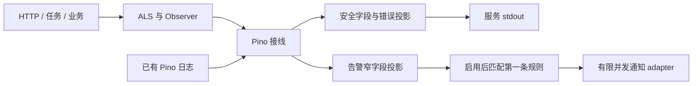

# 日志系统复用与告警配置设计

核查日期：2026-11-16。源码基线：`ca98570f`。本文区分当前实现与候选方案；文件规则加载、模块筛选及精确状态码筛选目前尚未实现，示例不能直接交给现有解析器使用。

## 1. 结论与适用范围

当前设计具备可复用的核心：结构化事件、AsyncLocalStorage 上下文、一次终态、受控错误投影、可插拔输出、显式 transport 包装，以及默认关闭的逐条日志告警。适合作为其他 Node.js / TypeScript 后端的集成模板。

它还不是复制整个目录即可使用的独立 SDK。项目字段、Fastify 路由映射、Prisma 性能 helper、Pino 约定、Sentry schema 与飞书通知启动存在本项目依赖。迁移时需要替换这些接缝；浏览器、Edge 和非 Node.js 项目不能直接复用 AsyncLocalStorage 运行时代码，可复用事件契约与接入检查方法。

建议先以“核心模板 + 项目适配 + 验收清单”复用，第二个实际项目接入后再决定是否发布共享包。当前无需为了复用先建立独立服务、日志库、队列、配置平台或通用规则语言。

## 2. 当前设计的灵活性



告警关闭时没有 consumer，直接跳过匹配/通知；日志仍正常输出。基础事件不受诊断 `LOG_LEVEL` 过滤，普通诊断日志若被过滤就不会产生告警。

| 能力                      | 当前可复用性                                     | 迁移时需要处理的边界                                                         |
| ------------------------- | ------------------------------------------------ | ---------------------------------------------------------------------------- |
| `createObserver(sinks)`   | 高：多个输出、故障隔离、同步/异步操作、一次终态  | 选择目标项目输出；不要把业务重试交给 logger                                  |
| ALS 与 trace/span/request | 高：并发隔离、嵌套 span、独立 job 根             | 改写业务字段投影；它不是完整 W3C 跨服务 trace 传播实现                       |
| HTTP 生命周期             | 中：成功、拒绝、超时、断开及 hijack SSE          | 当前使用 Fastify hook 和项目 envelope；其他框架重写 adapter                  |
| fetch transport           | 高：已有 `createObservedFetch(observer)` 注入点  | 默认 singleton 仍依赖本项目 runtime；原调用方负责 timeout/signal/重试/正文   |
| job                       | 中高：根上下文和实际结果分开                     | 当前默认 singleton 与独立 ALS 需按目标项目装配；reporter 必须留在同一作用域  |
| Prisma / Supabase / pg    | 中：接入方式可复用                               | Prisma helper 关联 `perf-metrics`；Supabase、pg 拓扑与锁生命周期属于项目适配 |
| 安全投影                  | 机制高、字段中：白名单、有限 cause、敏感内容抑制 | 用户/对象 ID、允许的错误码和短剧 DTO 都不能照搬成其他项目安全策略            |
| 告警匹配与投递隔离        | 中高：纯规则匹配、Delivery 接口、关闭无处理      | 启动器、SafeAlertCard 类型、飞书装配及 Backend/Railway 文案仍需适配          |
| CI / 规划门禁             | 方法可复用                                       | 检查脚本含仓库路径、SDK 注册名和例外；Trellis 元数据不是日志核心的必要依赖   |

核心也有明确的使用限制：默认 observer/Pino 和告警通道为进程级 singleton，job 使用模块级 ALS；适合本项目的进程装配，不能直接宣称支持同一进程中多个完全隔离的服务实例。`startLogAlerts` 的引用计数解决重复装配/关闭，不提供策略热切换。

## 3. 跨项目快速迁移清单

### 3.1 按依赖分组复制

| 层          | 当前文件                                                                                                                                                | 迁移方式                                                                              |
| ----------- | ------------------------------------------------------------------------------------------------------------------------------------------------------- | ------------------------------------------------------------------------------------- |
| 最小核心    | `platform/observability/core.ts`、`context.ts`、`events.ts`、`business-context.ts`                                                                      | 保留标准事件和上下文；把最后一个文件及 EventFields 的项目字段改成目标项目的有界白名单 |
| Pino 输出   | `lib/logger-options.ts`、`logger.ts`、`log-pretty.ts`，`observability/runtime.ts`、`safe-log.ts`、`log-channel.ts`，`shared/src/logging/conventions.ts` | 调整 import；移除短剧 DTO 等源项目特例；保留父/子 logger 安全绑定测试                 |
| 请求与调用  | `http.ts`、`http-business.ts`、`fetch.ts`、`jobs.ts`                                                                                                    | 先接根请求/job，再接外部调用；路由、身份、业务对象和 envelope 按新项目显式映射        |
| 数据访问    | `prisma.ts`、Supabase fetch 和 pg lease 接线                                                                                                            | 按实际 ORM/SDK 选择，保留原连接、事务、锁及取消，不为日志额外查询                     |
| 可选告警    | `alert-policy.ts`、`log-alerts.ts`、`log-channel.ts`                                                                                                    | 复用规则与投递生命周期；通知卡片/adapter、配置读取与服务名由目标项目提供              |
| 可选 Sentry | `sentry-safety.ts` 与 instrumentation hooks                                                                                                             | 只在目标项目采用该出口时引入，单独验证其 SDK 自动捕获边界                             |
| 质量门禁    | `scripts/check-backend-logging*.mjs`、`logging-boundary-checks.mjs`、规划规范                                                                           | 改仓库根目录和批准的 SDK/CLI 例外；禁止把原项目例外整体当作白名单移入                 |

基础目录位于 `packages/backend/src/`；表中的 shared 约定来自 `packages/shared/src/`。最小核心使用 Node 内置能力；Pino 输出需要 `pino`，pretty 为可选依赖，告警 schema 使用 `zod`。Fastify、Prisma、Supabase、Sentry 和飞书都应作为按需接入部分，不能要求每个项目全部安装。

`logger.ts` 的 Fastify 类型、`safe-log.ts` 的 `@miniapp/shared` 业务 schema、`alert-runtime.ts` 的运行时配置/通知装配，以及 `prisma.ts` 的性能 helper 是必须检查的 import。整目录复制会把这些依赖一起带走。

### 3.2 最小落地顺序

1. 定义服务名、固定事件字段、业务字段白名单、敏感数据禁区，以及 stdout 的部署捕获方式。
2. 接入核心和 Pino；先验证实际 JSON 和错误投影，再挂 HTTP 根上下文与请求 ID。
3. 为后台任务建立独立根；成功/失败/跳过由实际结果 reporter 确定，不以 Promise resolve 当作成功。
4. 接入外部 fetch/数据库；HTTP transport 到响应头为止，不把它当作正文消费或业务提交成功。
5. 逐业务补终态、公开/内部错误码和对象关联；并行实体用独立业务作用域，不在共享父容器上写最后一个实体的身份。
6. 接可选告警，默认关闭；开启后用模拟 sink 验证规则及投递失败隔离，再做目标环境实测。
7. 接入对应语言/仓库的 CI 检查及功能规划要求，记录仍未覆盖的语法和生产验收边界。

根事件契约应保留 `schema_version/event_id/module/operation/level/timestamp/trace_id/span_id`，可选 request/parent span，并区分 `outcome`、`outcome_known`、`http_status`、`upstream_status`、内部/公开错误码及耗时。已有 Pino 兼容日志不一定具有基础事件的全部字段，迁移时必须明确其归一化策略。

依赖版本要由目标项目锁定：本项目在 Pino `onChild` 使用其导出的 symbols 重建绑定缓存；升级后必须用真实输出验证嵌套 child 和 setBindings，不能只看 TypeScript 编译。Node.js 目标按本仓库要求为 22+；现有 Dockerfile 仍使用 Node 20，是部署基线差异，不应复制为新项目的默认选择。

### 3.3 迁移验收

| 场景                                 | 必须证明的结果                                                                        |
| ------------------------------------ | ------------------------------------------------------------------------------------- |
| 两个并发请求、嵌套操作、不同实体并行 | trace/身份不串；子 span 正确；共享缓存等待者各自绑定上下文                            |
| HTTP/SSE 正常、拒绝、超时、断开      | 一次终态；200 传输与业务结果分开；断开不能被之后的成功覆盖                            |
| 业务成功/失败，输出抛错/拒绝         | 业务只执行一次，原返回值和原异常不被替换                                              |
| Error/SDK 对象/cause/子 logger       | 允许的 code 保留；私密 message、URL、SQL 参数、正文与凭证不输出                       |
| 写操作超时                           | 保留未知提交结果，不因日志自动重复扣款/写入                                           |
| 告警关闭、命中/不命中、失败/过载     | 关闭无处理；顺序匹配正确；通知不影响业务，失败不递归告警                              |
| 目标部署平台                         | stdout 真能查询，event/request/trace 可以定位；本地测试不能替代平台保存和真实性能验收 |

不要把源项目的支付 outbox、告警监控表、运营配置库、短剧遥测或部署资源一起迁移。它们不是这套逐条日志告警所必需的组成部分。

## 4. 当前告警配置的实际能力

当前入口为 `platform/config.ts` → `parseLogAlertPolicy`，业务统一经 `runtime-config.ts#getLogAlertSettings` 读取；不是从运营配置表读取这份日志规则。

| 项目     | 当前行为                                                                                                        |
| -------- | --------------------------------------------------------------------------------------------------------------- |
| 开关     | `LOG_ALERTING_ENABLED` 默认关闭；仅字符串 true 开启                                                             |
| 规则来源 | `LOG_ALERT_RULES` 环境变量中的 JSON 数组；没有文件路径读取入口                                                  |
| 规则限制 | 1–32 条、唯一 id、严格 schema、输入字符串长度最多 16,384；关闭时不解析规则                                      |
| 等级     | `min_level` 默认为 error，可配置 info/warn/error/fatal                                                          |
| 筛选     | events、operations、error_codes、public_error_codes、outcomes 为精确列表；另有 min_http_status、min_duration_ms |
| 匹配     | 同一条规则的不同条件 AND；列表内任一值匹配；第一条命中即使用，不合并多条通知                                    |
| 默认     | 开启但未提供规则时匹配 error/fatal；自定义规则替换默认数组，不会隐式追加兜底                                    |
| 错误码   | error_codes 兼容内部或公开码；public_error_codes 只匹配公开码；都配置时仍为 AND                                 |
| Secret   | webhook 为独立部署 secret，不能写入规则文件、文档或日志                                                         |
| 生效方式 | 进程启动时读取，修改需要重启/重新部署；没有热更新                                                               |
| 投递     | 当前飞书 adapter，4 并发、2.5 秒、不重试、不持久化/补传，过载可丢弃通知                                         |

以下是**现在就支持**的规则内容，表示 HTTP 根操作状态至少 500：

```json
[
  {
    "id": "http-server-errors",
    "operations": ["http.request"],
    "min_http_status": 500,
    "min_level": "error",
    "severity": "P1"
  }
]
```

当前不能直接表达 `modules`、`business_modules`、`http_statuses` 或 `upstream_statuses`；这些键会被 strict schema 拒绝。`min_http_status: 400` 也包含 5xx，不能当作“仅 4xx”。供应商的 HTTP 429 在基础事件中是 `upstream_status`，当前告警窄投影没有保留它，不能拿 `min_http_status` 替代。

技术模块由操作/日志来源决定，例如 `http`、`db`、`payment`；业务模块描述来源业务，例如支付请求下的 HTTP/DB 事件可带 `business_module=payment`。只按技术模块 payment 过滤，无法覆盖所有支付 HTTP 根日志。

## 5. 文件化统一管理的候选方案

### 5.1 文件与职责

建议新增 `packages/backend/config/log-alerts.json`，让主服务与同包独立 worker 使用相同规则。它是代码仓库内的可审查配置，不引入数据库或运营页面。

| 内容                              | 建议管理方式                                                               |
| --------------------------------- | -------------------------------------------------------------------------- |
| 规则、模块/状态码条件、级别和顺序 | 一个版本化 JSON 文件，走 Git diff 与 CI                                    |
| 总开关                            | 保留 `LOG_ALERTING_ENABLED` 作为部署级开关，默认关闭                       |
| webhook/凭据                      | 保留部署 secret，文件不含凭据                                              |
| 特殊文件位置                      | 新增可选 `LOG_ALERT_RULES_FILE`；相对路径基于 Backend 包根，不依赖启动 cwd |
| 旧规则变量                        | 兼容已有 `LOG_ALERT_RULES`；与显式文件路径同时设置时启动失败，避免来源不清 |
| 环境差异                          | 首版用单文件和部署开关；确有不同规则时显式选择完整文件，不做多层隐式合并   |

关闭时先短路：不读取文件、不解析、不匹配或通知。开启时来源选择：显式旧 JSON 或显式文件二选一；两者都未设置则读取仓库默认文件，该文件初始只包含原 runtime-errors 规则，保持当前默认语义。

首版在启动时一次性读取并冻结策略，变更后重启/部署。文件缺失、超限、版本不支持或字段非法时 fail fast，不偷偷回退为空规则。文件 UTF-8 字节上限建议 16 KiB；保留最多 32 条规则，避免无界规则和正则/脚本求值。

现有 Backend Dockerfile 复制整个 `packages/backend`，有条件包含该目录；落地时仍需验证 `.dockerignore`、实际部署/worker 打包和容器内相对路径，不能只验证仓库中有文件。

### 5.2 拟扩展的字段

文件外壳：`{ "version": 1, "rules": [...] }`。旧环境变量继续接受原数组格式。现有规则字段保持兼容，候选新增字段如下：

| 字段              | 语义与校验                                                  |
| ----------------- | ----------------------------------------------------------- |
| modules           | 技术模块精确列表；只匹配事件实际 module，不靠字符串包含猜测 |
| business_modules  | 业务模块精确列表；使用经过白名单投影的业务上下文            |
| http_statuses     | HTTP 对调用方实际响应的状态码列表，整数 100–599             |
| upstream_statuses | DB/供应商 transport 的上游状态码列表，整数 100–599          |

新增列表保持有界，列表内 OR、列表间 AND；缺失事件字段不匹配。min_http_status 与 http_statuses 同时配置时继续 AND，不赋予隐式覆盖含义。内部错误码和公开错误码沿用现有分开匹配语义。首版不增加 wildcard、任意正则、动态脚本、窗口聚合、规则热更新或自动业务重试。

下面是**目标文件格式示意，尚未接入**；新字段不能直接粘贴到当前 LOG_ALERT_RULES：

```json
{
  "version": 1,
  "rules": [
    {
      "id": "payment-http-failures",
      "business_modules": ["payment"],
      "operations": ["http.request"],
      "http_statuses": [500, 502, 503, 504],
      "min_level": "error",
      "severity": "P1"
    },
    {
      "id": "payment-gateway-429",
      "modules": ["payment"],
      "operations": ["payment.transport"],
      "upstream_statuses": [429],
      "min_level": "warn",
      "severity": "P1"
    },
    {
      "id": "http-rate-limited",
      "operations": ["http.request"],
      "http_statuses": [429],
      "min_level": "warn",
      "severity": "P2"
    },
    {
      "id": "runtime-errors",
      "min_level": "error",
      "severity": "P1"
    }
  ]
}
```

兜底放最后，否则会先吃掉后面的 error 规则。保留兜底意味着其他模块的 error 仍会通知；若只想告警列出的模块，应显式移除兜底。删掉一条专项规则不等于静默该模块，因为它仍可能命中后续规则。warn 规则必须设置允许 warn 的 min_level；只配置 429 但沿用默认 error 不会匹配 warn transport。

### 5.3 需要改动的代码接缝

1. `alert-policy.ts`：扩展纯 schema/matcher；继续保留旧环境变量数组行为和 first-match 语义。
2. 项目配置 adapter：在 `platform/config.ts` 组装文件来源、开关和严格校验；继续通过 `runtime-config.ts#getLogAlertSettings` 对业务提供入口，不在业务模块读文件。
3. `log-channel.ts`：告警窄投影补 module/business_module/upstream_status；业务模块只来自安全上下文，身份/正文仍排除。
4. `alert-runtime.ts` / 通知装配：沿用现有有界直接投递，不增加持久化。是否展示新增的安全诊断字段由卡片投影决定，绝不把整个日志对象交给 adapter。
5. 配置校验命令与 CI：新增纯配置校验入口，例如候选 `logs:validate`，只验证文件/schema，不启动业务、连接数据库或发送通知。

文件只改变策略来源和可表达的条件，不自动接入遗漏的业务日志。业务仍必须产出正确模块、状态、错误码与终态。

## 6. 文件方案的验收与演进

| 条件                                      | 目标行为                                                               |
| ----------------------------------------- | ---------------------------------------------------------------------- |
| 开关关闭、文件不存在/非法                 | 零读取/零匹配/零通知，不影响启动                                       |
| 开启且文件缺失/非法/超限/版本不支持       | 启动失败，错误只给稳定分类，不回显文件正文、部署 secret 或底层私密错误 |
| 显式文件与旧 JSON 同时配置                | 开启时拒绝；没有不透明优先级                                           |
| 规则 ID 重复、未知键、状态码为字符串/越界 | 校验失败，CI 可提前发现                                                |
| module/payment 与 business_module/payment | 分别验证技术和来源业务，不混淆 HTTP/DB 事件                            |
| http_status=200、upstream_status=429      | 只命中上游条件，不能伪装 HTTP 根状态；业务结果另看 outcome/code        |
| 同时有多个条件或多条规则                  | 条件 AND、列表 OR、第一条命中一次通知，兜底顺序固定                    |
| 主服务与 worker、不同 cwd/容器运行        | 同一配置文件可读、加载路径一致、规则版本一致                           |
| 通知失败、超时、过载、关闭                | 沿用有限并发/截止/不递归；不影响业务结果                               |

先完成纯 parser/matcher/来源选择与测试，再接装配、CI 和文档，最后在目标环境保持总开关关闭验证文件随部署存在；开启及真实投递按独立部署操作核验。回滚代码前先把文件还原为旧字段规则或使用旧 JSON，避免新增规则字段落到旧 strict schema 上。

未来提取公共包时，核心接受已经解析的 policy 和 Delivery，文件 I/O、环境变量与 secret 留在项目装配层；服务名和日志查询提示也由装配层提供。不要把 Railway、飞书或 MiniApp 的业务目录写成公共核心的固定依赖。

## 7. 当前产物与后续范围

本轮完成源码能力核查、复用边界、迁移步骤及可评审的文件配置契约；没有发布公共 SDK，也没有实现上述文件加载/新增筛选字段。当前运行行为与规则仍以 [运行说明](backend-observability-runtime.md) 为准。

后续若落地，最小交付为一个规则文件、一个有界来源读取入口、四个筛选字段、配置校验与对应回归。优先补这几个接缝，再由第二个项目验证复用接口，避免先建设大而通用的日志平台。
